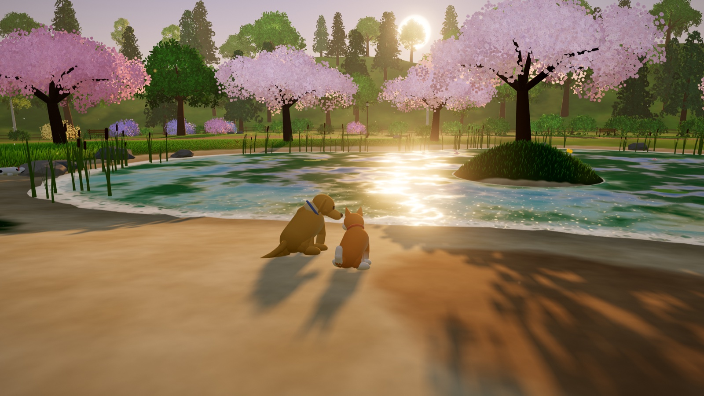

# Playground

Small experiments: games, toys and prototypes. Each folder is a separate project, and every project that runs in the browser is published at **https://eduardmur.github.io/playground/**.

| | Project | Links |
| --- | --- | --- |
| <a href="https://eduardmur.github.io/playground/pawse/"></a> | **Pawse**<br>A meditative 3D game: you are a dog in a park. Three.js. | [Play](https://eduardmur.github.io/playground/pawse/) · [Code](pawse/) |

## Adding an experiment

1. Make a new top-level folder, for example `my-idea/`.
2. Put the project in it in one of these shapes:
   - **Built project** (Vite, etc.): a `package.json` with a `build` script that writes the site to `dist/`. Use relative asset paths (for Vite, `base: './'`).
   - **Plain page**: an `index.html` with no build step. It is published as it is.
   - **Anything else** (scripts, notes): it is listed with a link to its code.
3. Optionally describe it in `package.json`:
   ```json
   "description": "One line about it.",
   "playground": { "title": "My Idea", "tags": ["game"], "date": "2026-12-01" }
   ```
4. Add screenshots to `my-idea/screenshots/` (JPEG around 1600 px wide keeps the repo light). Files are used in name order, so number them: `1-main.jpg`, `2-detail.jpg`. The first one is the cover in the table above and on the site; a `cover.jpg` in the project folder takes priority if you want a different one.
5. Add a row to the table above and push to `main`. GitHub Actions rebuilds the site, and the project appears at `https://eduardmur.github.io/playground/my-idea/`.

To check the site locally: `node scripts/build-site.mjs` (or `node scripts/build-site.mjs my-idea` for one project), then open `_site/index.html` through any static server.
