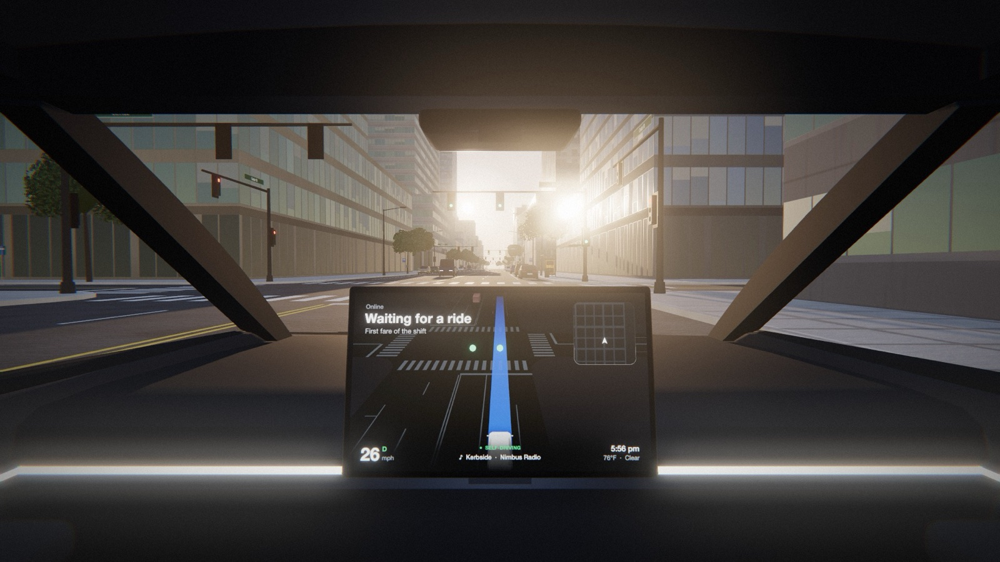
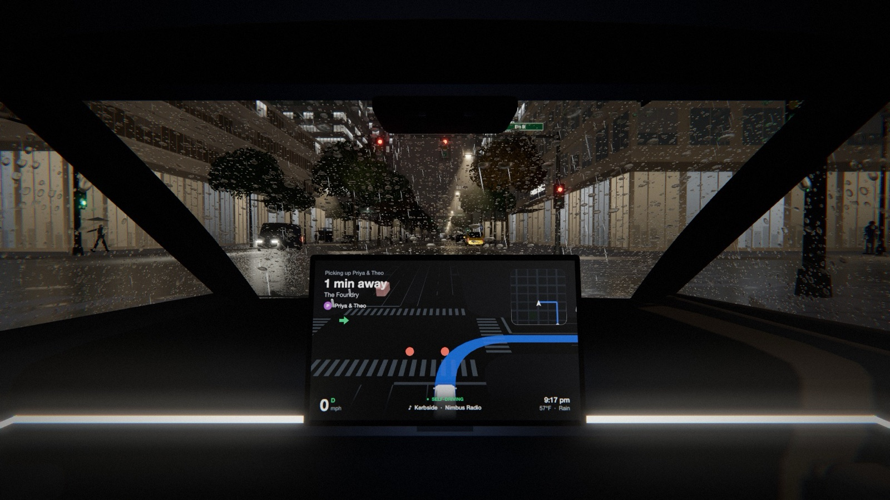
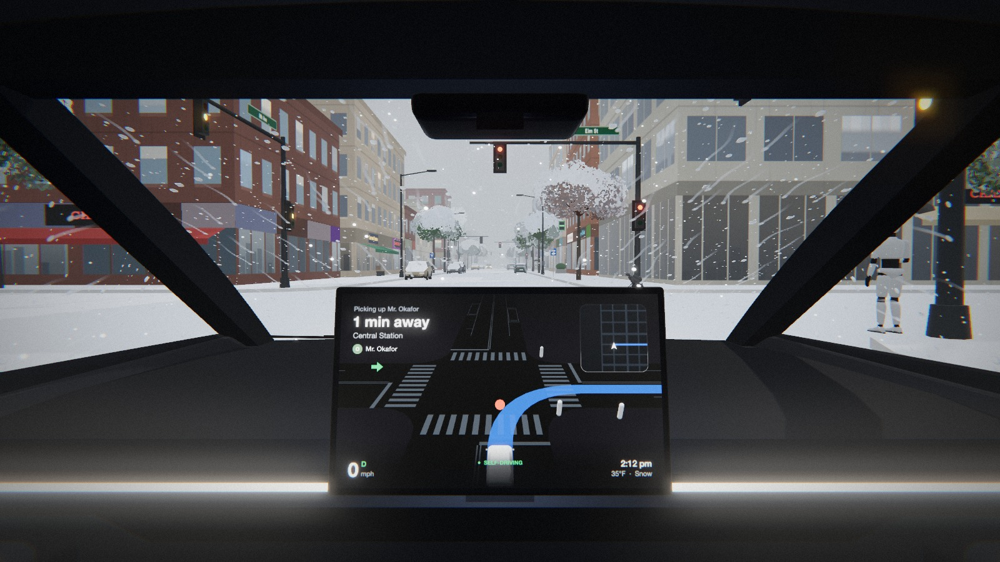
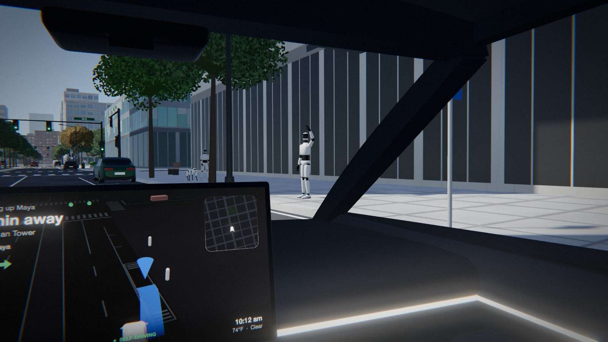
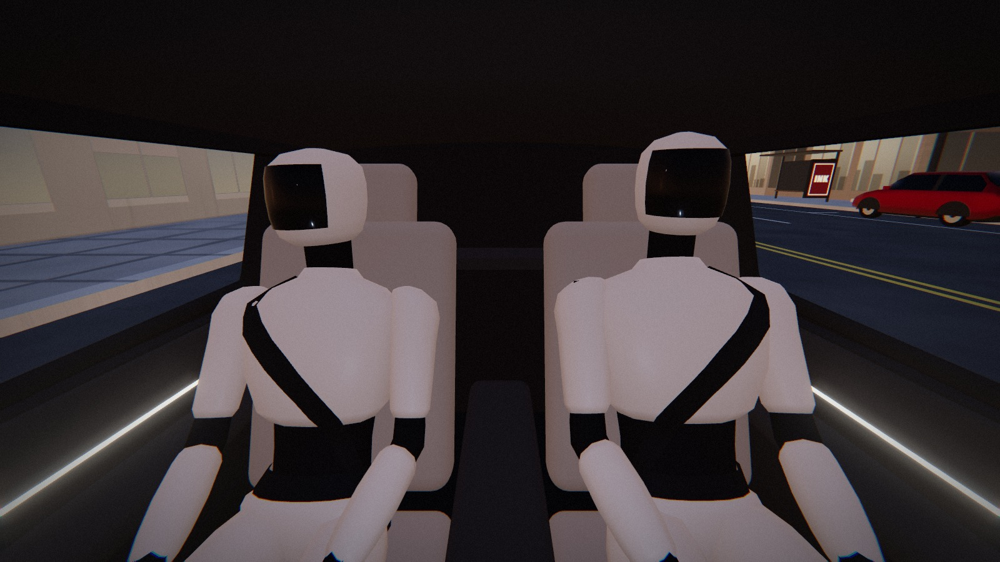

# Fare Weather

A lofi robotaxi shift in a city of robots. Nobody is driving: you ride along in a driverless cab as it picks robots up, takes them where they are going, and listens. Change the sky whenever you like.

**Play it: https://eduardmur.github.io/playground/fare-weather/**



| | |
| --- | --- |
|  |  |
| Rain at night | Snow |
|  |  |
| A fare flags the cab down | Riders, from the cab's own camera |

Built with [Three.js](https://threejs.org/), with [Lucide](https://lucide.dev/) icons in the interface. The city, the cars, the cabin, the robots and the weather are all generated in code: there are no model or texture files. Sound is the exception by design: every sound has a built-in synthesised stand-in, and each one is replaced by a real recording as soon as you add it (see [Sound](#sound)).

## Run it

```bash
npm install
npm run dev
```

Then open the address Vite prints (http://localhost:5173 by default). `npm run build` writes a static site to `dist/` that can be hosted anywhere.

## Play

There is nothing to steer and nothing to start: the game opens in the middle of a ride, with someone already on board. The cab takes fares on its own; you look around, set the weather and the hour, and overhear whoever is riding. Sound begins with your first click or key press, because a browser will not let a page make any before that.

| Input | What it does |
| --- | --- |
| Drag | Look around |
| Scroll | Zoom |
| Double-click | Look straight ahead again |
| `1` to `6` | Clear, cloudy, rain, storm, fog, snow |
| `0` | Let the weather change by itself |
| `[` `]` | An hour earlier, an hour later |
| `T` | How fast the day passes: hold, real time, drift, fast |
| `C` | Change the view: the front seat, behind the seats, or the cab's camera on its riders |
| `M` `N` | Radio on or off, next track |
| `Tab` | Weather and time panel |
| `J` | Riders you have met |
| `H` | Hide the interface |

The row of controls in the top corner opens three small panels: weather and time, sound (radio, the three volumes, subtitles) and settings (view, picture quality, the keys above).

Things to notice:

- Fourteen riders have something to say, and most only ride at certain hours: a baker before dawn, friends after a concert at night. The Riders page keeps a line about each one you have carried.
- Wipers, headlights and street lamps look after themselves. Rain beads on the glass, runs up the windscreen at speed and back down at a red light, and stays out of the arc the wiper clears.
- Wet roads mirror the street. Snow settles and muffles the tyres. Fog turns every lamp into a cone.
- At about six in the evening the sun sets straight down the east-west streets.
- The city belongs to robots: plain machines, a pale shell over a dark frame and a blank visor, one much like the next. Its shops are theirs too: battery swaps, repair, oil bars, spare parts. Some robots walk a dog; some dogs are out alone with a parcel on their back, and sit down to wait for the lights.
- What the riders say is robot life: an interview that went well, a grandson running hot, an exam on cell chemistry, a wedding cake nobody at the wedding can eat.
- Whoever ordered the ride waits at the kerb and flags the cab down as it comes up the street. In the rain they wait under an umbrella.
- The second rider of a pair walks round the front of the car to the far door.
- Riders buckle up, look out of the window and turn to whoever is talking.
- The radio leans toward tracks that suit the weather and the hour.

## Sound

The game plays from `public/audio/` wherever a recording exists and falls back to its own synthesis everywhere else: generated lo-fi on the radio, noise-and-filter stand-ins for the car and the street, and subtitles alone for voices. So it is complete without any audio files, and any file can be taken out or swapped on its own.

Every sound has a recording now, all made with ElevenLabs: 31 sound effects, six radio tracks, the car's voice and all fourteen rides (17 voices, 60 spoken clips). Together they are about 32 MB.

[ELEVENLABS.md](ELEVENLABS.md) has a prompt for every sound, track, voice and spoken clip, each under the file name the game expects (the extension can be `.m4a`, `.mp3`, `.wav` or `.ogg`):

```
public/audio/sfx/door_open.m4a
public/audio/music/rainy_window.m4a
public/audio/voice/car/welcome_1.m4a
public/audio/voice/maya/hello.m4a
```

With the dev server running, the page reloads by itself when a file appears. Any extra file in `public/audio/music/` joins the radio playlist.

The prompts and the riders' scripts live in `src/audio/manifest.js` and `src/data/riders.js`. After editing either, run `npm run prompts` to regenerate `ELEVENLABS.md`.

### From takes to recordings

A file dropped into `public/audio/` by hand works as it is. The recordings that are there now went through one more step, because generated takes arrive at very different volumes, with silence around them, and one line of speech at a time:

```bash
npm run audio            # everything in takes/ -> public/audio/
npm run audio -- voice   # or only sfx, music or voice
```

- `takes/` holds the raw takes (it is not in git): `takes/<kind>/index.json` lists them as `{ label, take, file }`, several takes to a label where there are any.
- Sound effects are trimmed to the sound itself and levelled to match the stand-in they replace, so the volumes in the manifest keep their meaning. Beds also lose everything under 30 Hz: generated ambience carries a lot of rumble down there that nobody hears and that eats headroom.
- Each spoken line is recorded on its own; the build brings the lines to one loudness (holding down only the peaks that stand in the way), joins them into one file per clip with pauses between them, and notes when each line starts, so the subtitles change on the word.
- Where a label has several takes the build picks one by measurement. `takes/picks.json` overrides that, and can keep only part of a take: `{ "sfx/blinker": { "take": 2, "keep": [[0.174, 0.212]] } }`. An entry can also ask for a longer fade-out, for a take that was cut off mid-sound (`"fade": 0.5`), or for a higher low cut on a bed (`"highpass": 100`).
- The model does not play a set number of notes, however it is asked. A sound with `notes` in the manifest is therefore one recorded note played once per `[seconds, semitones]`: the request chime is a single marimba note, played twice.
- What the game needs to know about a recording (extra gain, line timings) is written to `src/audio/recordings.json`. If you replace one of these files by hand, remove its entry there.
- `AUDIO_OUT=<folder> npm run audio` builds into that folder instead, to look at the result before it goes into the game.

The build decodes and encodes with `afconvert`, so it runs on macOS.

## How it is put together

```
src/
  main.js            entry point
  game.js            owns the renderer, the world and the frame loop
  core/              input, the frame pipeline, maths helpers
  world/
    city.js          the city as data: roads, blocks, lanes, turns, signals, kerbside zones
    ground.js        asphalt, pavements, paint; one shader for wet, puddles and snow
    buildings.js     boxes plus a facade shader (windows, brick, shop fronts, lit rooms), signs
    props.js         lamps, traffic signals, street-name signs, street furniture
    trees.js         crowns made of camera-facing leaf cards
    sky.js           sun and moon, clouds, fog, the baked sky used for reflections
    weather.js       weather state, falling rain and snow, lightning
  sim/
    traffic.js       cars: lane following, car following, signals, right of way
    ego.js           the cab: routing, lane changes, pulling in and out
    pedestrians.js   robots and dogs on the pavements and crosswalks
    rides.js         the shift: request, pick-up, conversation, drop-off
  car/
    cabin.js         the interior, its doors and its light
    glass.js         raindrops, runs of water, mist and the wiper
    screen.js        the dashboard display: a small 3D view plus a drawn interface
    models.js        cars lofted from a few numbers per body style
    passenger.js     a rider in a seat: the belt, and the cake if there is one
  robots/
    frame.js         a humanoid robot as one skinned mesh: under-frame, plain shells, visor, hands
    looks.js         the little that tells one robot from the next: build and shade
    robot.js         the rig and its material: standing, walking, flagging the cab, ducking in, sitting
    dog.js           the four-legged kind: at heel, or out alone with a parcel
  fx/lights.js       glows, pools of light on the road, shafts under lamps
  audio/
    engine.js        mixing; recordings where they exist, stand-ins where they do not
    manifest.js      every sound and track with its prompt
    recordings.json  what the build noted about each recording it made
    synth.js         the stand-ins
    lofi.js          the generated radio
  data/riders.js     voices and scripts
  ui/hud.js          controls and their panels, subtitles, the Riders page
scripts/
  build-prompts.mjs  writes ELEVENLABS.md
  audio-tools.mjs    measures takes and builds the recordings from them
```

A frame is drawn in layers: the street mirrored in the road (only when it is wet), the street itself, then the cabin over that image, with the window glass sampling it so that each raindrop can bend the view behind it.

Handy URL options while tinkering: `?t=21.5` sets the hour, `?w=rain` sets the weather (`clear`, `cloudy`, `rain`, `storm`, `fog`, `snow`), `?flow=0` stops the clock, `?cam=rear` or `?cam=riders` starts in one of the other views, `?rider=maya` opens with that rider on board (any id from `src/data/riders.js`), `?q=low` or `?q=high` changes the picture quality. In the console, `game.skip(60)` runs the simulation a minute ahead. Progress is kept in `localStorage`; "Start a fresh shift" on the Riders page clears it.
