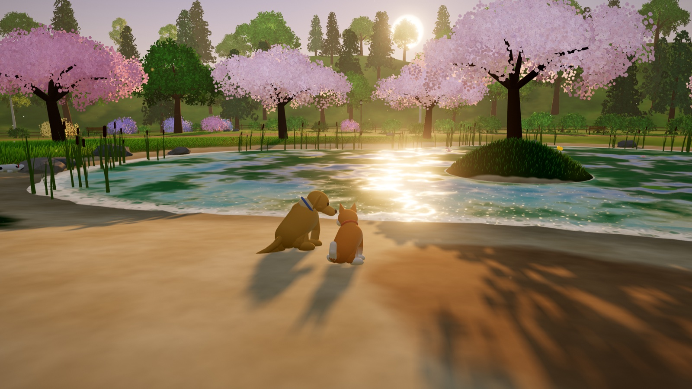
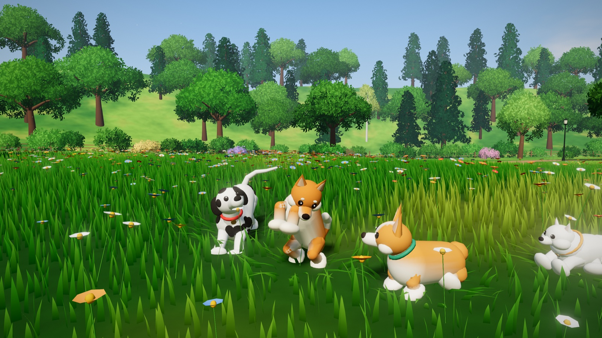
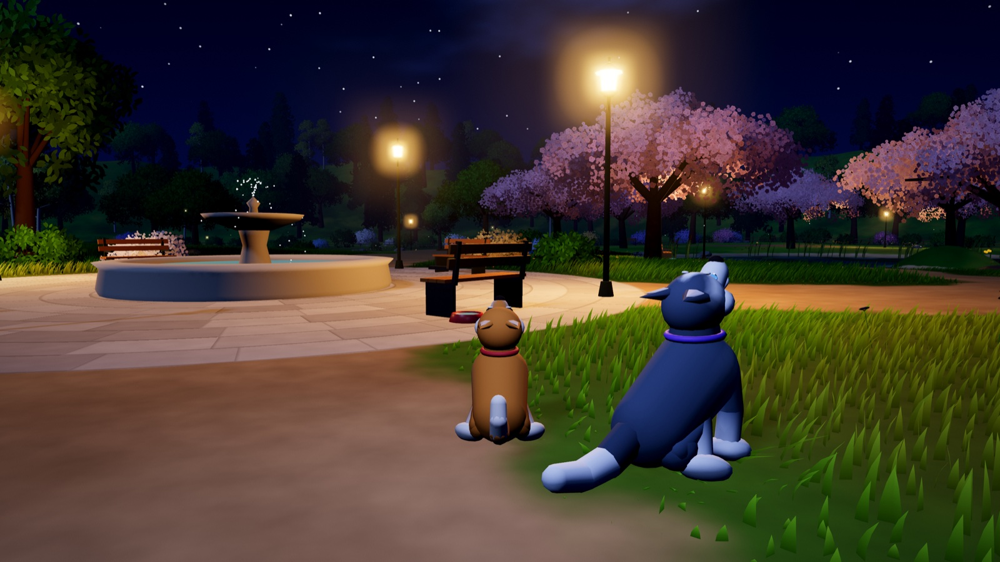

# Pawse

A quiet day at the dog park. You are a dog. There is nowhere you need to be.

**Play it: https://eduardmur.github.io/playground/pawse/**



| | |
| --- | --- |
|  |  |
| Making friends in the meadow | Howling at night by the fountain |

Built with [Three.js](https://threejs.org/). Everything on screen and everything you hear is generated in code: there are no models, textures or audio files.

## Run it

```bash
npm install
npm run dev
```

Then open the address Vite prints (http://localhost:5173 by default). `npm run build` writes a static site to `dist/` that can be hosted anywhere.

`npm run build:artifact` packs the game into a single page (`dist/pawse-artifact.html`) for publishing as a claude.ai Artifact: all of the game's own code and styles are inlined, and three.js is loaded from cdnjs.

## Play

| Key | What it does |
| --- | --- |
| `W` `A` `S` `D` | Walk |
| `Shift` | Run |
| `Space` | Jump |
| `E` | Sniff, say hello, drink, pick up, toss, dig (whatever makes sense right now) |
| `1` to `7` | Sit, lie down, roll over, spin, paw, beg, play bow |
| `F` `H` `R` | Bark, howl, shake dry |
| Drag, scroll | Look around, zoom |
| `T` | Let time drift ahead to the next part of the day |
| `J` | Little joys (the journal) |
| `P` `M` `/` | Hide the interface, music on/off, help |

On a touch screen, drag on the left side to move and on the right side to look.

Things to try:

- Say hello to the other dogs. Friends follow you around and copy your tricks.
- Play-bow (`7`) at a dog to start a game of tag.
- Pick up the tennis ball on the north lawn and toss it near a friend.
- Run at the pigeons. Swim to the island. Shake.
- Lie down and stay a while. Sit on the hill at sunset. Stay until the fireflies come out, then howl.
- One dog is shy. Sit quietly near her.

There is no score. The journal just keeps track of the small things you have noticed.

## How it is put together

```
src/
  main.js            entry point
  game.js            owns the renderer, the world and the frame loop
  core/              input, camera rig, maths and noise helpers
  world/
    terrain.js       height field, paths and the pond basin
    grass.js         ~235k instanced blades that wrap around the camera,
                     lean with the wind and part around the dogs
    trees.js         painterly foliage made of camera-facing leaf cards
    flora.js         wildflowers, rocks, reeds, lily pads
    water.js         pond shader (depth from the terrain, ripples, sun glitter)
    sky.js           day and night: sun, moon, stars, clouds, fog, light
    props.js         benches, lamps, fountain, fence
  entities/
    breeds.js        dog breeds and the park regulars
    dogRig.js        builds a dog from a breed description
    dog.js           procedural animation: leg IK, gaits, postures, tricks
    player.js        you
    npc.js           the other dogs (wander, greet, tag, fetch, nap...)
    critters.js      bird flocks and butterflies
    items.js         biscuits, golden bones, the ball, sticks, dig spots
  fx/particles.js    petals, splashes, hearts, fireflies, dust motes
  audio/audio.js     synthesised barks, birdsong, water and a generative score
  ui/                title screen, HUD, journal
```

Handy URL options while tinkering: `?autostart` skips the title, `?t=20.2` starts at a given hour, `?q=low` renders at lower resolution. Progress is kept in `localStorage`; "Start a fresh day" in the journal clears it.
