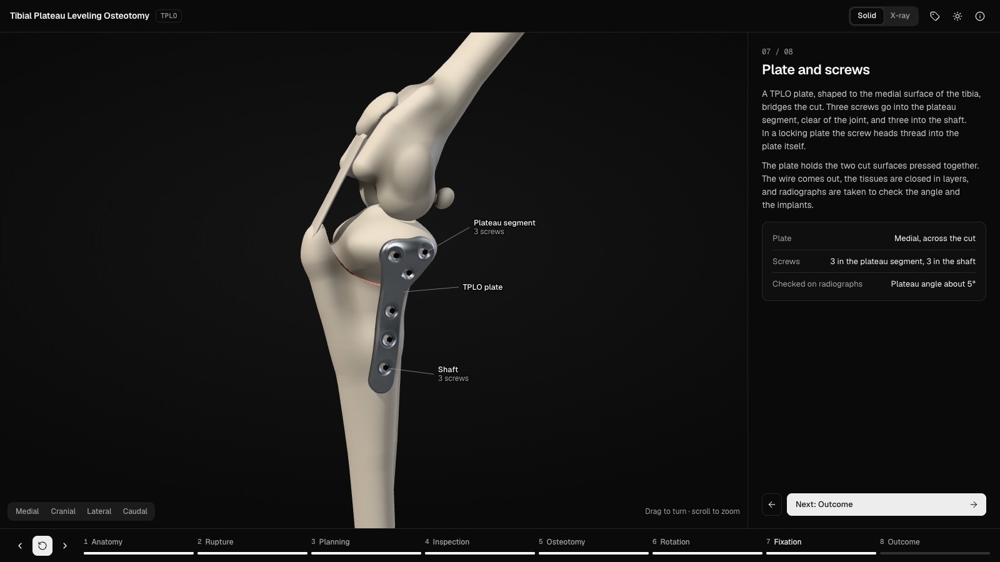
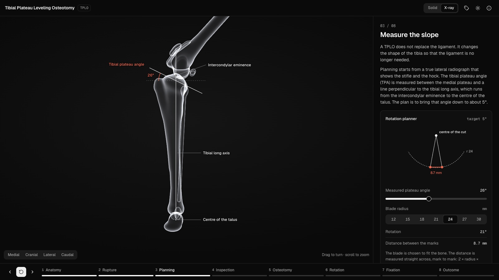
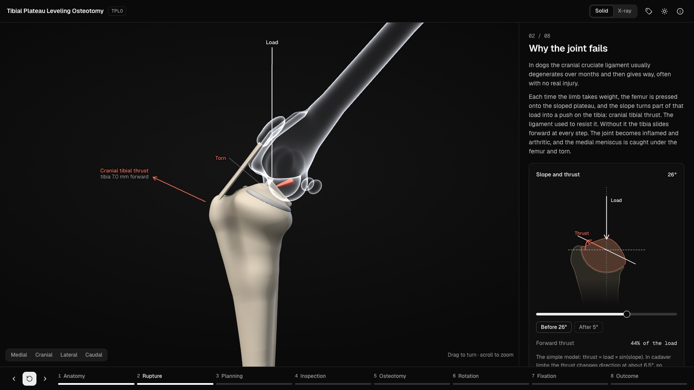
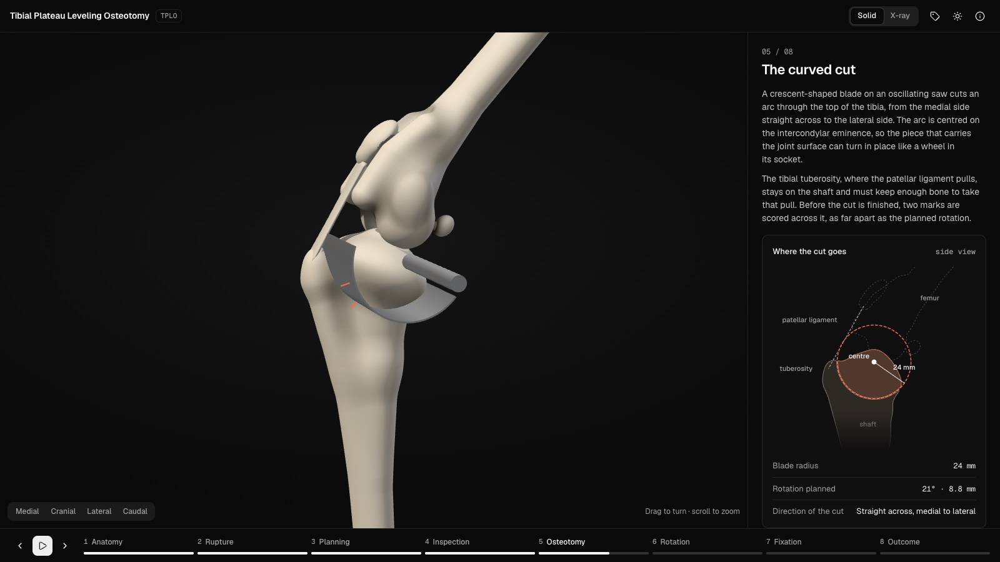
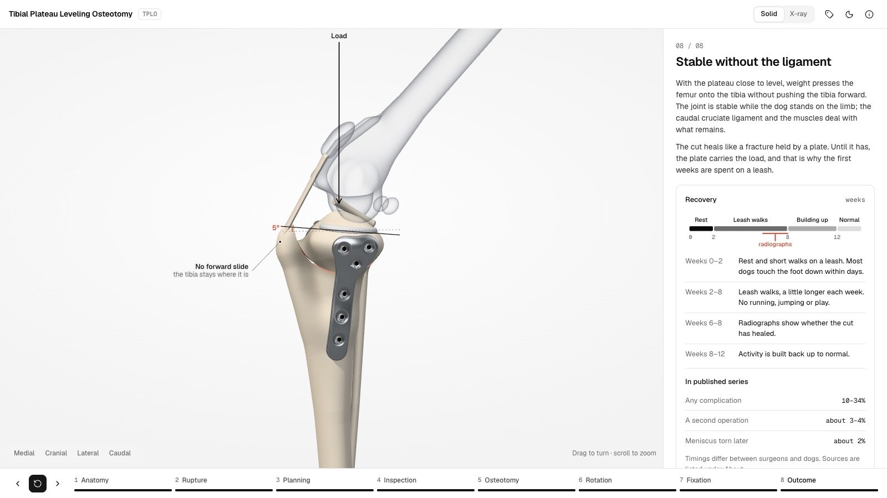

# Tibial Plateau Leveling Osteotomy (TPLO)

How the operation is done, step by step, on a 3D model of a dog's stifle: why a torn cranial cruciate ligament makes the joint slide, how the slope of the tibia is measured, where the curved cut goes, how the plateau is turned level, and how it is held with a plate.

**Open: https://eduardmur.github.io/playground/tplo/**



| | |
| --- | --- |
|  |  |
|  |  |

## The eight steps

1. **Anatomy.** The bones of the stifle, the patellar ligament, the two cruciate ligaments and the menisci.
2. **Rupture.** The ligament tears; under load the tibia slides forward up its own slope. A scheme lets you change the slope and see the thrust change.
3. **Planning.** The tibia as on a radiograph, with the long axis and the plateau angle. A planner gives the rotation and the distance between the marks for any angle and blade.
4. **Inspection.** The torn ends are removed and the medial meniscus is checked.
5. **Osteotomy.** The planned arc, the rotation marks, and the blade going through.
6. **Rotation.** The plateau segment turns from 26° to 5°; the angle and the travel along the cut are read off as it moves.
7. **Fixation.** The plate and its six screws.
8. **Outcome.** The same load on the levelled plateau, the weeks of recovery, and how often things go wrong.

## What you can do

- **Step through it**: the buttons under the text, the timeline at the bottom, `←` `→`, or `1`–`8`.
- **Play, pause, scrub**: `Space`, or drag along the timeline to move through a step by hand.
- **Look around**: drag to turn, scroll to zoom, right-drag to move. Medial, Cranial, Lateral and Caudal put the camera on that side; a double click puts it back.
- **X-ray** (`X`): every bone becomes see-through and the implants solid, as on a radiograph.
- **Labels** (`L`) and **light or dark** (`T`).

## How it is made

Three.js, TypeScript, Vite. No backend and no downloaded models.

- **The bones are written as formulas.** Each one is a smooth blend of a few rounded solids, given as a signed distance field in `scripts/sdf.mjs`. `npm run model` turns the fields into meshes with marching cubes (`scripts/mc.mjs`), bakes soft shading into the vertices, and writes one packed file, `public/model/stifle.bin`, with a manifest beside the source. The plate is made the same way, bent to the surface of the tibia as it is after the rotation.
- **The cut is exact.** The tibia is one mesh drawn twice: once keeping what lies inside the blade's circle, once what lies outside, decided per pixel in the shader (`src/scene/materials.ts`). The two sawn faces are separate meshes whose rims sit on the bone's surface. The kerf opens only as far as the blade's tip has gone.
- **Everything measured comes from the model.** Label anchors, screw lengths, the outlines in the 2D schemes and the marks on the bone are all computed from the same fields, so the schemes and the 3D view cannot disagree.
- **Annotations** are an SVG layer over the canvas (`src/scene/overlay.ts`): lines, arcs and labels are given at points of the model and placed on screen every frame.
- **The walkthrough** is data (`src/steps.ts`): each step has its text, a camera, a function that poses the model at any moment of the step, and a function that draws its annotations.

The model is built as a left stifle and mirrored, so from the medial side the front of the limb is on the left, as on a radiograph.

## Accuracy

The stifle is stylised, not a scan: a right limb of a dog of about 30 kg, with a plateau angle of 26°, a 24 mm blade and a rotation of 21° (8.7 mm between the marks). The page explains the idea and the order of the steps. It is not a surgical guide and not veterinary advice.

The numbers in the text come from these papers, also listed in the page under About:

- Slocum B, Slocum TD. *Vet Clin North Am Small Anim Pract* 1993;23:777–795 (the operation).
- Warzee CC et al. *Vet Surg* 2001;30:278–286 (thrust against plateau angle).
- Ralphs SC, Whitney WO. *J Am Vet Med Assoc* 2002;221:1601–1604 (meniscal tears at surgery).
- Bergh MS, Peirone B. *Vet Comp Orthop Traumatol* 2012;25:349–358 (complications, review).
- Coletti TJ et al. *Can Vet J* 2014;55:249–254 (complications in 1519 procedures).
- Gatineau M et al. *Vet Comp Orthop Traumatol* 2011;24:333–341 (476 procedures, later meniscal tears).
- Christopher SA, Beetem J, Cook JL. *Vet Surg* 2013;42:329–334 (long-term outcome).

## Running it

```bash
npm install
npm run dev
```

`npm run build` type-checks and writes the site to `dist/`. `npm run model` rebuilds the model after a change to `scripts/sdf.mjs`.

For looking at one moment: `#rotation` opens a step, and `?t=0.5` holds it halfway; `?theme=light` picks the theme.
