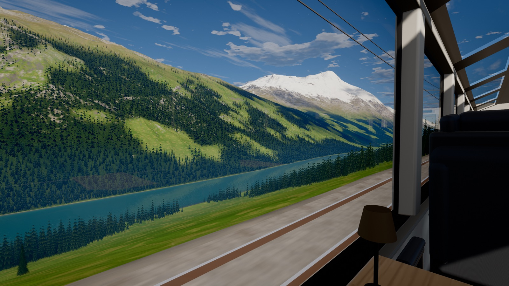
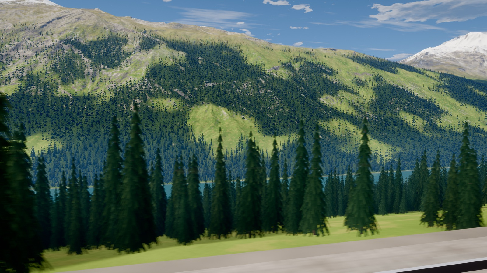
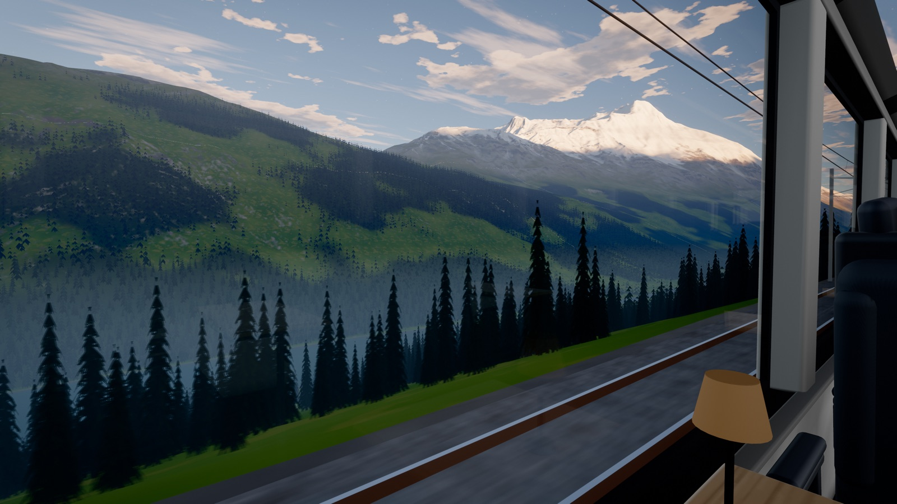
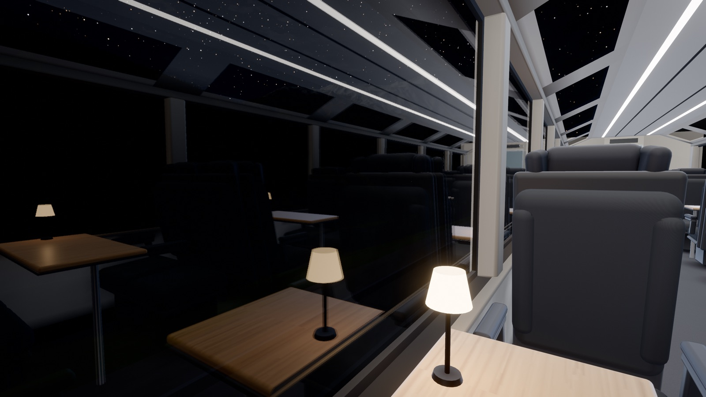
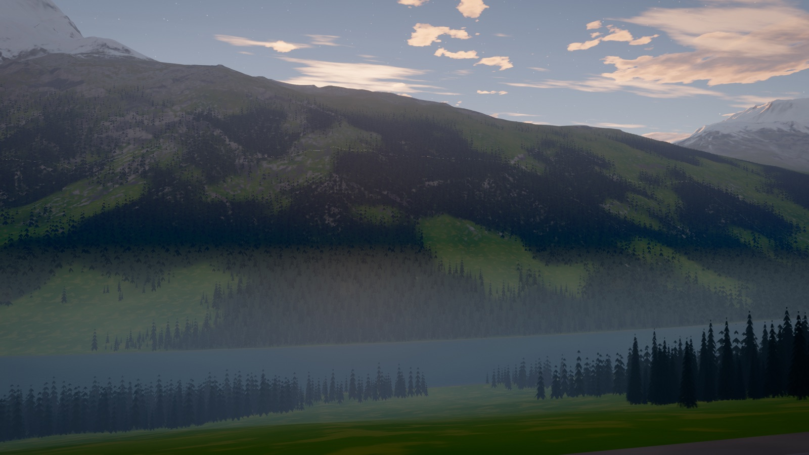

# Pomodoro train

A quiet ride in a window seat through high mountains. There is no goal: the train is already moving when the page opens, and it goes on for as long as you like. A place to work, or to do nothing.

**Play: https://eduardmur.github.io/playground/train/**



| | |
| --- | --- |
|  |  |
|  |  |

## What you can do

- **Look around**: drag. You are sitting down, so you can turn as far as a seated person can.
- **Lean to the window**: click the window, or press `F`. The carriage drops out of view and the interface with it. `Esc` or `F` sits you back.
- **Change the time of day**: `T`, then drag through the twenty-four hours, or `[` and `]` for half an hour at a time. The day can also be left to pass by itself, a whole day every three hours.
- **Keep a pomodoro timer**: `P` opens it, `Space` starts and pauses it. 25 minutes of work, 5 of rest, a longer rest after four rounds; the lengths can be changed. A bell marks each change and the time left shows in the tab's title. The ride takes no notice of the timer.
- **Play the radio**: four lo-fi stations (Morning, Focus, Dusk, Night). `R` turns it on and off, `N` moves to the next station.
- **Set the sound**: separate volumes for the radio and the train, `M` to mute. Sound starts with the first click or key press, as browsers require.
- **Fullscreen**: `Shift` + `F`.

The bar steps back after a few seconds without the mouse moving. Settings are kept between visits.

## How it is made

Three.js on WebGL 2, TypeScript, Vite. No backend, no downloaded models or textures: everything seen is generated.

- **The line and the land** come from one function of position, so the route is endless and never repeats. The land is drawn into a stack of height textures centred on the train (a clipmap: `src/world/bake.ts`), a strip at a time as the train moves; the mesh, the forest, the water and the shadows all read those. The same integer hash drives a twin of the route on the CPU (`src/world/route.ts`), so the track the train is put on is the track the GPU carved.
- **Along the line** (`src/world/trackside.ts`): two tracks, masts and wires, cuttings and banks, tunnels where the ground stands 13 m over the rails for long enough, viaducts where it falls 9 m below.
- **The sky** is a physically based atmosphere after Hillaire (`src/world/atmosphere.ts`): the same tables colour the sky, the haze in front of far mountains and the light on the land at every hour, with a moon, stars and the Milky Way at night. Clouds are a lit layer that also throws moving shadows on the ground.
- **The carriage** (`src/train/`) is built from simple solids with baked ambient shading, lit by the sun through the windows (with a shadow map), by an environment map gathered from everything that glows, and by its lamps after dusk. The windows mirror the cabin, doubled as two panes do.
- **The picture** (`src/render/pipeline.ts`): linear floating-point light, motion blur for what is near the line, bloom, exposure and white balance that follow what is in view, AgX tone mapping. The resolution comes down by itself if a machine cannot hold sixty frames a second.

## Sound

All sound is recorded, none synthesised: ten effects (the carriage at speed, a tunnel, a viaduct, wind at the window, tunnel mouths, a far horn, the timer's bell, the radio's tuning) and twelve tracks of music, generated with ElevenLabs from the prompts in `src/audio/manifest.json`.

`npm run audio` rebuilds `public/audio/` from the raw takes in `takes/` (not in the repository): it picks the steadiest take of each loop and the cleanest of each short sound, trims, levels and encodes them. It needs macOS (`afconvert`).

## Running it

```bash
npm install
npm run dev
```

`npm run build` type-checks and writes the site to `dist/`.

For looking at things: `?t=18.5` sets the hour, `?x=120` starts 120 km down the line, `?cam=out&up=300&pitch=-30` takes the camera out of the train.
